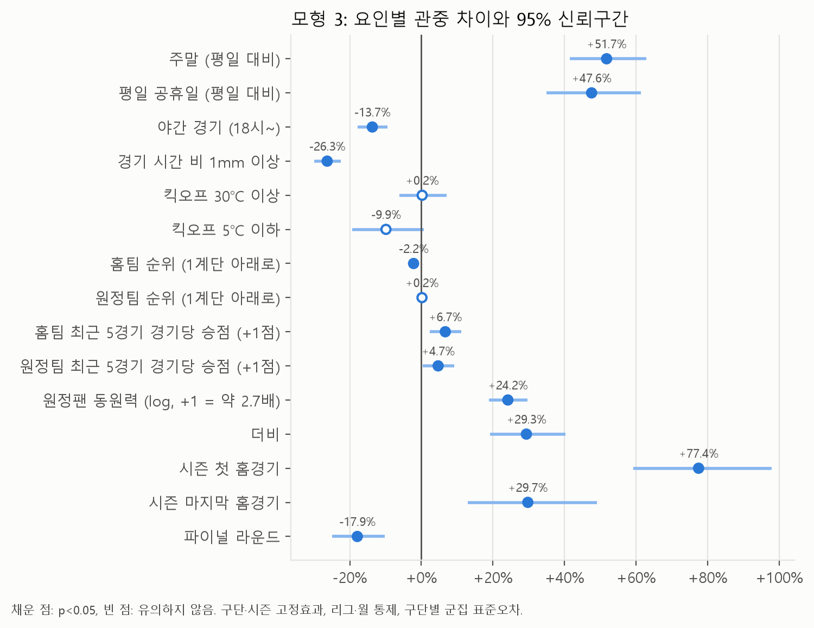
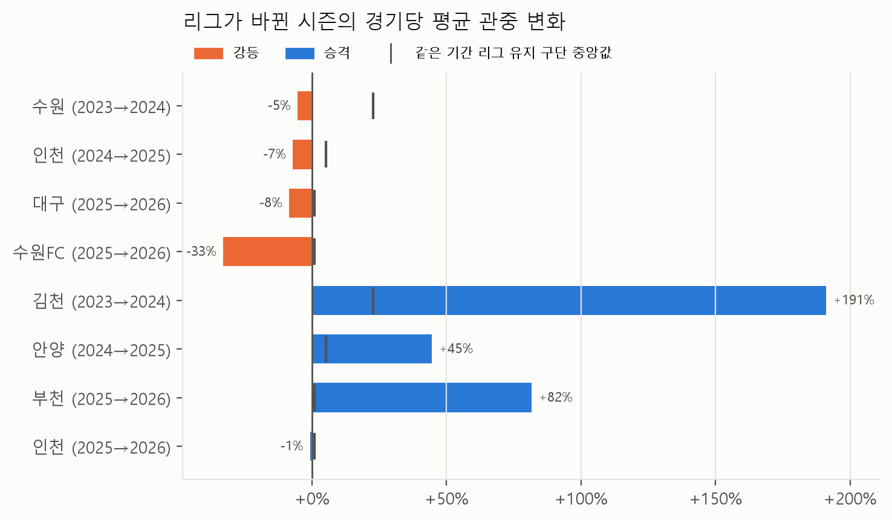

# K리그 관중 결정요인 분석

**"어떤 경기에 관중이 더 오는가"를 공개 데이터로 분석하고, 구단 마케팅 담당자가 바로 쓸 수 있는 시사점으로 정리한 프로젝트입니다.**

2023~2026시즌 K리그1·K리그2 홈경기 1,849경기를 경기 단위로 분석했습니다. 일정·날씨·경기력·상대팀이 관중과 어떤 관계인지, 구단·시즌 고정효과 회귀분석으로 추정했습니다.

## 한눈에 보는 결론

같은 구단의 경기끼리 비교했을 때(다른 조건이 같다면) 결과는 아래와 같습니다. 모두 인과가 아니라 연관성입니다.

| 요인 | 관중 차이 |
| --- | --- |
| 시즌 첫 홈경기 | **+77%** |
| 주말 (평일 대비) | **+52%** |
| 평일 공휴일 (평일 대비) | **+48%**, 주말과 거의 같음 |
| 시즌 마지막 홈경기 | +30% |
| 더비 | +29% |
| 원정 팬이 2배인 팀과의 경기 | +16% |
| 홈팀 최근 5경기 경기당 승점 +1점 | +7% |
| 주말·공휴일 저녁 경기 (낮 경기 대비) | −14% |
| K리그1 파이널 라운드 | −18% |
| **경기 시간 전후 비 (1mm 이상)** | **−26%** |
| 킥오프 기온 30℃ 이상 | 뚜렷한 관계 없음 |



### 사례: 수원 삼성은 강등 뒤 어떻게 관중을 지켰나

- 강등 첫해(2024) 관중은 −5%로 강등 구단 중 가장 적게 줄었습니다. 그러나 그해 리그를 유지한 구단들은 보통 +23% 늘어서, 리그 흐름보다는 28%p 뒤처졌습니다.
- 강등 3년차인 2026년에는 K리그1 시절(2023)보다 관중이 36% 많았습니다.
- K리그2 시절 수원 관중은 **성적과 거의 관계가 없었고**(경기당 승점 +1점당 +2%), 주말·인기 원정팀·더비와 관련이 컸습니다.



## 구단 마케팅 담당자가 할 수 있는 일 (예시)

> **예시입니다.** 아래 제안은 분석 결과에서 떠올린 아이디어로, 실제 효과가 확인된 것은 아닙니다. 실제 제안은 다른 리그·구단의 성공 사례를 근거로 다시 작성할 예정이며, 사례는 [docs/benchmark_cases.md](docs/benchmark_cases.md)에 모으고 있습니다.

| 분석 결과 | 제안 (예시) |
| --- | --- |
| 평일 공휴일 관중이 주말과 비슷 | 일정 협의 때 평일 공휴일 홈경기 배정을 요청하고, 가족 단위 프로모션 집중 |
| 경기 시간 비 −26% | 강수 예보 기반 관중 예측으로 인력·매점 재고 조정, 우비 제공·예매 취소 정책으로 이탈 줄이기 |
| 첫·마지막 홈경기, 더비 +29~77% | 이미 관중이 몰리는 경기는 객단가(굿즈·먹거리)를 높이고, 다음 경기 할인권으로 신규 팬 전환 |
| 원정 팬이 많은 상대와의 경기 관중 증가 | 인기 원정팀 경기에 원정석 확대·원정 팬 패키지 판매 |
| 파이널 라운드 −18% | 순위 경쟁이 끝난 경기용 별도 이벤트(시즌권 갱신 행사 등) 기획 |
| 강등 구단 관중은 성적과 관계가 약함 | 성적 홍보보다 경기장 경험·팬 커뮤니티에 투자하고, 더비·인기 상대 경기를 핵심 상품으로 묶기 |

## 분석에서 신경 쓴 점

**1. 결과를 보기 전에 기준을 먼저 정했습니다.**
더비 목록, 제외 경기, 공휴일, 날씨 기준, 민감도 분석 방법을 모형을 돌리기 전에 확정하고 [CLAUDE.md](CLAUDE.md)와 커밋 기록에 남겼습니다. 결과를 보고 유리하게 기준을 바꾸는 일을 막기 위해서입니다.

**2. 측정을 실제 상황에 가깝게 고쳤습니다.**
- **날씨:** 처음에는 하루 전체 강수량을 썼지만, 하루 기준으로 '비 온 경기' 480개 중 실제 경기 시간에 비가 온 것은 165개뿐이었습니다. 그래서 기상청 시간자료로 **킥오프 1시간 전~2시간 후** 날씨를 다시 만들었습니다.
- **상대팀 인기도:** 그 경기의 원정 관중은 관중 수의 일부라 그대로 쓰지 않고, 원정팀이 **지난 원정경기들**에서 데려온 관중 평균을 썼습니다. 원정석이 꽉 차서 숫자가 정원에서 멈춘 것으로 보이는 경기(예: 대구 홈경기는 원정 관중이 622명에서 반복해서 멈춤)는 평균에서 뺐습니다.
- **경기력:** 순위와 최근 성적은 **경기 전날까지의 결과**로만 계산했습니다. 2023~2025 K리그1 최종 순위가 실제와 일치하는지 확인했습니다.

**3. 결과가 기준에 따라 흔들리는지 확인했습니다.**
매진으로 보이는 경기 33개를 빼거나, 날씨를 다른 관측소 기준으로 바꿔도 대부분의 계수가 1~2%p 안에서 움직였습니다. 가장 크게 바뀐 시즌 마지막 홈경기도 +30%에서 +26~33%로, 결론은 같았습니다.

**4. 한계를 숨기지 않았습니다.**
원정석 밖에 앉은 원정 팬은 집계되지 않는 점, 경기 시간은 연맹이 정한다는 점 등 결과 해석에 필요한 한계를 [docs/limitations.md](docs/limitations.md)에 정리했습니다.

## 데이터

| 데이터 | 출처 | 수집 방법 |
| --- | --- | --- |
| 경기별 관중·결과 | [K리그 관중 현황](https://www.kleague.com/record/audienceDetail.do) | 직접 복사 후 코드로 정리 |
| 킥오프 시간·라운드·중계 | [K리그 일정/결과](https://www.kleague.com/schedule.do) | 월별 페이지 직접 복사 후 코드로 정리 |
| 날씨 (일자료·시간자료) | 기상청 ASOS ([공공데이터포털](https://www.data.go.kr) API) | API 자동 수집 |
| 공휴일 | 법정 공휴일 + 근로자의 날 | 직접 작성 |
| 더비 | 한국어 위키백과에 단독 문서가 있는 더비 10쌍 | 직접 작성 |

- 분석 범위: 2023~2026시즌 정규 리그 경기. 코로나 영향이 있는 2020~2022년은 뺐습니다. 2026시즌은 10월 25일까지입니다.
- 제외: 홈구장 공사 등으로 정규 홈구장이 아닌 곳에서 열린 14경기.
- K리그 사이트는 robots.txt로 자동 수집을 막고 있어 **크롤링하지 않았습니다.** 원본은 직접 복사하고, 정리만 코드로 자동화했습니다. 원본·가공 데이터는 저장소에 올리지 않습니다.

## 분석 방법

- **모형:** log(관중 수)를 종속변수로 한 OLS 회귀분석
  - 구단·시즌 고정효과와 리그·월 통제를 넣어 '같은 구단 안에서' 비교합니다.
  - 표준오차는 구단별 군집 표준오차입니다.
- **단계적 모형:** 모형 1(일정·날씨) → 모형 2(+경기력) → 모형 3(+상대팀·특별 경기). 수정 R²는 0.78 → 0.80 → 0.86입니다.
- **확인:** 다중공선성(VIF) 점검, 민감도 분석 2가지(매진 경기 제외, 대체 관측소 날씨)
- **사례 분석:** 리그가 바뀐 구단 8곳의 전후 비교, K리그2에서 성적과 관중의 관계

| 노트북 | 내용 |
| --- | --- |
| [01_descriptive.ipynb](notebooks/01_descriptive.ipynb) | 기술통계: 시즌·구단별 관중, 조건별 단순 비교 |
| [02_models.ipynb](notebooks/02_models.ipynb) | 회귀 모형 1~3, VIF, 민감도 분석, 해석 |
| [03_suwon_case.ipynb](notebooks/03_suwon_case.ipynb) | 수원 삼성 사례 분석 |

## 프로젝트 구성

| 단계 | 내용 | 상태 |
| --- | --- | --- |
| 1 | 관중 결정요인 분석 (경기 단위 회귀분석) | **완료** |
| 2 | 예측 모델 비교 (회귀 vs 트리 모델 vs MLP, SHAP 해석) | 예정 |
| 3 | 팬 텍스트 감성분석 | 예정 |
| 4 | 자동 갱신 대시보드 (수집 → 재학습 → 배포) | 예정 |

## 폴더 구조

```
kleague-attendance-analysis/
├── data/
│   ├── raw/                 # 직접 복사한 관중 표·일정, API로 받은 날씨 (Git 제외)
│   ├── external/            # 직접 정한 목록: 더비, 공휴일, 정규 홈구장, 경기장-관측소 대응표 등
│   └── processed/           # 스크립트가 만든 분석용 데이터 (Git 제외)
├── src/
│   ├── collect/             # 관중 표·일정 정리, 날씨 API 수집, 제외 경기 목록
│   └── features/            # 경기 직전 순위·성적, 분석용 변수 만들기
├── notebooks/               # 기술통계, 회귀 모형, 수원 사례 분석
├── reports/                 # 결과 그림, 모형 3 계수표
├── docs/                    # 분석 한계, 검토 체크리스트, 연구 설계 요약
└── requirements.txt
```

## 실행 방법

```bash
pip install -r requirements.txt
```

1. 관중 표와 일정 페이지를 복사해 `data/raw/attendance/`, `data/raw/schedule/`에 저장합니다. 방법은 각 스크립트 맨 위 설명에 있습니다.
2. 공공데이터포털에서 기상청 ASOS 일자료·시간자료 API를 신청하고, 프로젝트 최상위 `.env` 파일에 `KMA_API_KEY=발급받은키`를 넣습니다.
3. 아래 순서로 실행한 뒤 `notebooks/`의 노트북을 차례로 엽니다.

```bash
python src/collect/kleague_attendance_merge.py   # 관중 표 정리
python src/collect/kleague_schedule_merge.py     # 일정(킥오프 시간) 정리
python src/collect/build_excluded_matches.py     # 제외 경기 목록
python src/collect/fetch_weather.py              # 날씨 일자료 (API)
python src/collect/fetch_weather_hourly.py       # 날씨 시간자료 (API)
python src/features/team_form.py                 # 경기 직전 순위·성적
python src/features/build_features.py            # 분석용 데이터
```
